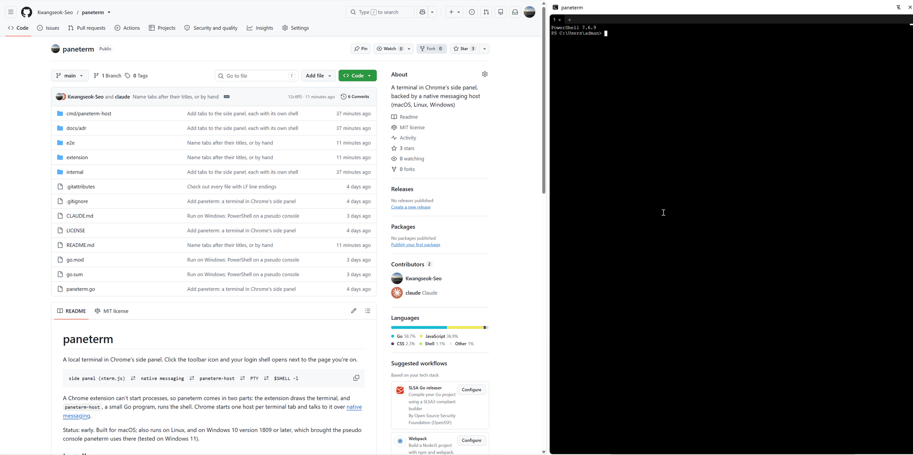

# paneterm

A local terminal in Chrome's side panel. Click the toolbar icon and your
login shell opens next to the page you're on.



```
side panel (xterm.js)  ⇄  native messaging  ⇄  paneterm-host  ⇄  PTY  ⇄  $SHELL -l
```

A Chrome extension can't start processes, so paneterm comes in two parts:
the extension draws the terminal, and `paneterm-host`, a small Go program,
runs the shell. Chrome starts one host per terminal tab and talks to it over
[native messaging](https://developer.chrome.com/docs/extensions/develop/concepts/native-messaging).

Status: early. Built for macOS; also runs on Linux, and on Windows 10
version 1809 or later, which brought the pseudo console paneterm uses there
(tested on Windows 11).

## Install

You need Go 1.22 or later and Google Chrome 116 or later.

```sh
git clone https://github.com/Kwangseok-Seo/paneterm
cd paneterm
go install ./cmd/paneterm-host     # puts paneterm-host in $(go env GOPATH)/bin
paneterm-host install              # tells Chrome where the host is
```

Then load the extension:

1. Open `chrome://extensions` and turn on **Developer mode**.
2. Click **Load unpacked** and pick the `extension` folder.
3. Pin paneterm to the toolbar and click it.

`paneterm-host install` records the binary's absolute path. If you move or
rebuild it somewhere else, run `install` again. To remove the registration,
run `paneterm-host uninstall`.

On Windows, `install` writes the host manifest to `%APPDATA%\paneterm`
and points Chrome to it from a registry key under
`HKEY_CURRENT_USER\Software\Google\Chrome\NativeMessagingHosts`, which is
where Chrome looks there. `uninstall` removes the key and the folder.

## Using it

- Each tab runs its own shell. **+** opens a tab and **×** closes one,
  which hangs up its shell, the same as closing a terminal window. Closing
  the last tab starts a fresh shell, and closing the panel hangs up all of
  them.
- A tab is named by the title its shell or a program in it sets, and by
  its number when there is none. Double-click a tab to name it yourself;
  clearing the name gives it back to the title.
- When the shell exits, press Enter to start a new one.
- The shell's environment has `TERM_PROGRAM=paneterm`, the variable
  Terminal.app, iTerm2 and VS Code set to their own names, so your rc
  files can tell paneterm's shells apart.
- On Windows the shell is PowerShell 7 (`pwsh`) if it is installed, and
  Windows PowerShell otherwise.
- If the panel says `Specified native messaging host not found`, run
  `paneterm-host install`.

## Security

The extension can run any command as you. That is the point, so it is
worth knowing what can reach it:

- **Only this extension can start the host.** The host manifest's
  `allowed_origins` lists one extension ID, which is fixed by the `key` in
  `extension/manifest.json`.
- **Web pages can't talk to the extension.** It declares no
  `externally_connectable` and injects no content scripts.
- **Nothing listens on the network.** The host speaks only over the pipes
  Chrome gives it, unlike terminals served from a localhost port.

## Limitations

- Google Chrome only. Other Chromium browsers (Arc, Brave, Edge) read host
  manifests from their own folders or registry keys, which `install`
  doesn't write yet.
- On macOS, files that programs in the shell create carry Chrome's
  quarantine attribute (`com.apple.quarantine`), as if Chrome had
  downloaded them: Chrome's `Info.plist` sets `LSFileQuarantineEnabled`,
  and the shell runs under Chrome. Gatekeeper may then warn about an
  unsigned library that a program unpacks and loads, such as the native
  transport of Netty, a Java library. Your rc file can test `TERM_PROGRAM`
  to set such a program up differently in paneterm.
- On Windows there is no way yet to pick a shell other than PowerShell.
- No keyboard shortcuts for tabs yet, no splits, and no sessions that
  survive closing the panel.
- Some company policies block native messaging hosts
  (`NativeMessagingBlocklist`) or unpacked extensions. Check
  `chrome://policy` if the panel can't connect.

## Development

```sh
go test ./...      # session tests are per OS: Unix PTY or Windows ConPTY
e2e/run.sh         # needs Docker: drives the extension in Chromium
```

The e2e run loads the extension into Chromium on Linux, registers the host
with `paneterm-host install`, and checks commands, non-ASCII text, resizing,
Ctrl-C, bulk output, tabs and their names, exit and restart, cleanup after closing tabs and
panels, and that a web page has no way to reach the extension.

The protocol between panel and host is documented on `session.Message`.

## License

MIT. The vendored [xterm.js](https://xtermjs.org) files under
`extension/vendor/xterm` are also MIT; see the license files there.
